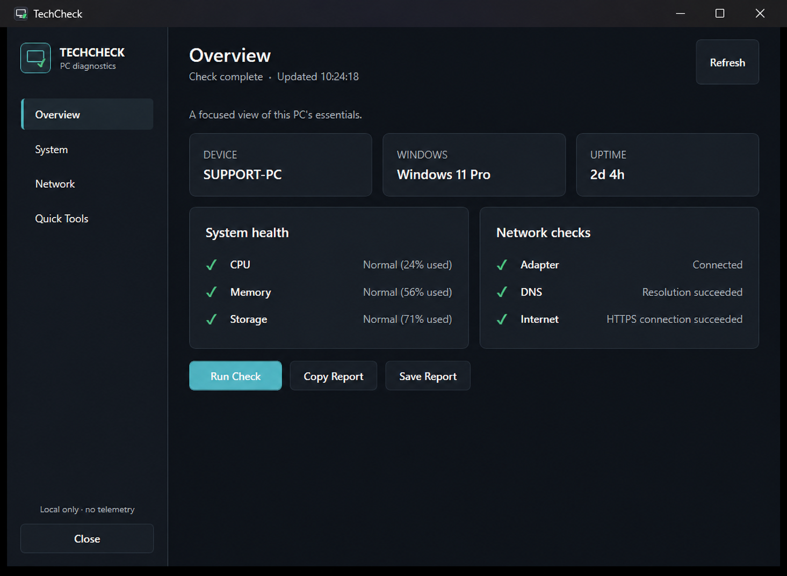

# TechCheck

TechCheck is a small, read-only Windows PC and network diagnostic utility for helpdesk technicians, desktop support staff, and technically inclined users. It presents practical information in one compact dark interface, then exits completely when closed.

## Features

- Overview of device, Windows version, user, uptime, and simple CPU, memory, and storage status
- Focused computer, processor, memory, and primary Windows-drive details, including manufacturer, model, and serial number when Windows makes them available
- Active adapter, IPv4, subnet, gateway, DNS, and MAC information
- On-demand adapter, DNS-resolution, and HTTPS connectivity checks with short timeouts
- Plaintext reports that are copied or saved only when requested
- Launchers for Task Manager, Device Manager, Event Viewer, Network Connections, Windows Settings, Windows Update, Command Prompt, and PowerShell
- Dark mode only, no elevation requirement, no continuous polling, and no background component

## Screenshot



## Technology stack

- C# 12 and .NET 8
- WPF for the native Windows desktop interface
- Built-in .NET and Windows APIs for diagnostics, networking, native tool launching, and shortcuts
- PowerShell and CMD for reproducible build, packaging, installation, and uninstallation
- A dependency-free console test harness for core logic

The projects contain no third-party NuGet packages, web runtime, database, service, or cloud component.

## Requirements

- Windows 10 22H2 or Windows 11 on an x64 PC
- No administrator privileges for normal use or per-user installation
- The release package is self-contained and does not require a separately installed .NET runtime
- Building from source requires Windows with WPF build support and the .NET 8 SDK selected by `global.json`

Internet access is not required to launch TechCheck or view local information. Only the explicit connectivity check uses the network.

## Use TechCheck

1. Launch `TechCheck.exe` or the installed Desktop shortcut.
2. Wait for the initial system and connectivity check to finish.
3. Open **Overview**, **System**, **Network**, or **Quick Tools** for the relevant details and launchers.
4. Select **Run Check** or **Refresh** to collect a new point-in-time snapshot; TechCheck does not poll continuously.
5. Select **Copy Report** to place the plaintext report on the clipboard, or **Save Report** to choose a `.txt` destination.
6. Select **Close** or the standard Windows `X` to cancel active work, release resources, and terminate the process.

## Build

From a PowerShell prompt in the repository root:

```powershell
powershell -NoProfile -File .\scripts\build.ps1
```

The build script restores the solution, regenerates the original multi-size icon using only Windows/.NET drawing APIs, and builds Release by default. For a Debug build:

```powershell
powershell -NoProfile -File .\scripts\build.ps1 -Configuration Debug
```

## Test

```powershell
powershell -NoProfile -File .\scripts\test.ps1
```

The test script builds the solution and runs the dependency-free test executable covering formatting, thresholds, diagnostic-result mapping, reports, and unavailable/error states. It also accepts `-Configuration Debug`.

To regenerate only the icon:

```powershell
powershell -NoProfile -File .\scripts\generate-icon.ps1
```

## Run from source

```powershell
dotnet run --project .\src\TechCheck\TechCheck.csproj --configuration Release
```

Close the standard Windows `X` or the in-app **Close** button to terminate TechCheck. It does not minimize to the tray.

## Package

```powershell
powershell -NoProfile -File .\scripts\package.ps1
```

This runs the tests, publishes a self-contained single-file `win-x64` application, and creates:

- `outputs\TechCheck-win-x64\`
- `outputs\TechCheck-win-x64.zip`
- `outputs\TechCheck-win-x64.sha256`

Extract the ZIP, open the `TechCheck-win-x64` folder, and double-click `TechCheck.exe` for portable use.

To verify the ZIP against the generated checksum:

```powershell
(Get-FileHash .\outputs\TechCheck-win-x64.zip -Algorithm SHA256).Hash
Get-Content .\outputs\TechCheck-win-x64.sha256
```

The hash printed by the first command should match the first field in the checksum file.

## Install

1. Extract the complete release ZIP.
2. Open the extracted `TechCheck-win-x64` folder.
3. Double-click `Install-TechCheck.cmd`.
4. Use the new **TechCheck** Desktop shortcut.

The installer copies only the application, icon, and uninstall files to `%LOCALAPPDATA%\TechCheck` and creates the shortcut in the current user's actual (including redirected) Desktop folder. It requests no elevation and creates no service, task, startup entry, or background process.

## Uninstall

Close TechCheck, then double-click:

```text
%LOCALAPPDATA%\TechCheck\Uninstall-TechCheck.cmd
```

The same `Uninstall-TechCheck.cmd` in an extracted release package can also be used. It removes the per-user application directory and Desktop shortcut. No system-wide files or registry entries are installed.

## Privacy and security

All diagnostic information stays on the PC. TechCheck has no telemetry, analytics, advertising, accounts, cloud storage, remote logging, update downloader, or network listener. The only outbound traffic is a bounded DNS lookup and HTTPS request to `example.com`, performed at launch or when the user runs or refreshes a check. No collected system details are included in that request, and reports are never stored automatically.

Diagnostic reports can contain device and network identifiers such as the computer name, username, serial number, IP configuration, and MAC address. Review a report before sharing it outside your support workflow.

TechCheck does not execute user-supplied commands, repair settings, install drivers, modify the registry, or silently elevate. Quick Tools launch fixed, native Windows utilities only.

## Architecture

`TechCheck` is a .NET 8 WPF application containing the Windows diagnostic and UI integration. `TechCheck.Core` holds dependency-free models, formatting, status thresholds, and report generation so those rules can be tested without WPF. Diagnostics are gathered on demand with cancellation and graceful unavailable states; there is no database or long-running worker.

## Repository structure

```text
TechCheck/
├── assets/                  Icon and repository screenshot
├── scripts/                 Build, test, package, install, and uninstall scripts
├── src/
│   ├── TechCheck/           WPF UI, view model, and Windows diagnostic services
│   └── TechCheck.Core/      Models, formatting, health rules, and report generation
├── tests/
│   └── TechCheck.Tests/     Dependency-free core-logic test executable
├── AGENTS.md                Permanent engineering guardrails
├── Directory.Build.props    Shared compiler and quality settings
├── global.json              .NET SDK selection
└── TechCheck.sln            Solution entry point
```

`outputs/`, `work/`, and ordinary .NET build products are generated locally and intentionally excluded from source control.

## Manual acceptance checklist

Release candidates should be checked on a normal, non-administrator Windows account:

- [ ] **Launch:** no console window; compact dark UI renders; initial diagnostics complete without freezing.
- [ ] **System:** computer, Windows, memory, storage, and uptime appear; unavailable optional fields do not crash.
- [ ] **Network:** active adapter details load when present; DNS and Internet tests pass, fail, or time out gracefully.
- [ ] **Reports:** Copy Report reaches the clipboard; Save Report creates a readable `.txt` only at the chosen path.
- [ ] **Quick Tools:** every button opens the intended built-in Windows utility.
- [ ] **Shutdown:** both Close and `X` exit; no TechCheck process remains in Task Manager.
- [ ] **Residency:** no TechCheck service, scheduled task, startup entry, tray icon, or idle polling remains.
- [ ] **Install:** non-admin install uses `%LOCALAPPDATA%\TechCheck`; redirected Desktop shortcut opens with the TechCheck icon.
- [ ] **Reopen:** the Desktop shortcut starts a fresh process normally after closing.
- [ ] **Uninstall:** app files and shortcut are removed; no system-wide residue remains.

## Known limitations

- Version 1 supports x64 Windows only and reports one primary active IPv4 network path and the Windows drive rather than inventorying every adapter or disk.
- Some manufacturer, model, serial, gateway, or adapter details may be `Unavailable` when Windows does not expose them to a standard user.
- DNS or HTTPS filtering, captive portals, and authenticated proxies can make the connectivity check fail even when some network access is available.
- Connectivity and resource results describe the moment the check ran; TechCheck is not a monitoring, benchmarking, or hardware-failure prediction tool.
- Release artifacts are not code-signed, so Windows may show a reputation warning when they are first downloaded.

## Future ideas

- Optional code signing and a conventional installer if distribution needs grow
- An ARM64 package after validation on ARM hardware
- Accessibility and layout refinements informed by real helpdesk use
